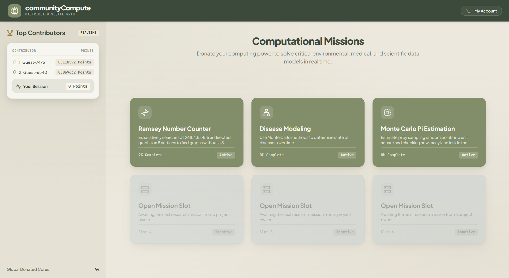

# [communityCompute](https://community-compute.org/)

> **HackGT Submission** | *Democratizing high-performance computing for social good through the browser.*

---

##  Overview

Built in a team with [Dutch Clarke](https://www.linkedin.com/in/dutch-clarke-845267392/) [Caleb Gurbaxani](https://www.linkedin.com/in/caleb-gurbaxani-90466830b/) [Mohammed Alam](https://www.linkedin.com/in/mohammed-alam-4182353a1/) [Karthik Vishwanatham](https://www.linkedin.com/in/karthik-vish/) [Rashad Bijli](https://www.instagram.com/allu_scent/)

**communityCompute** is an open, distributed browser-based compute network built to tackle massive computational challenges in mathematics, medicine, and environmental science. 

Instead of requiring users to download heavy desktop software or configure complex cluster environments, **communityCompute** allows anyone with a web browser to contribute their idle processing power directly to active scientific missions. By simply opening a browser tab, users join a worldwide grid of micro-nodes working together on high-impact research.

---

##  Features

- **Zero-Install Participation:** Join the computing grid in one click—no downloads, browser extensions, or setup required.
- **Granular Power Control:** Real-time hardware controls (power sliders) allow contributors to cap resource utilization to fit their device setup without overheating or slowing down daily tasks.
- **Active Research Missions:** Support real-world workloads ranging from graph theory (e.g., Ramsey Number Counter) to complex disease modeling and climate simulations.
- **Real-Time Telemetry & Dashboards:** Live updates on completed tasks and personal contribution stats.
- **Background Task Execution:** Web Workers process computational workloads in isolation without lagging or freezing the main UI thread.

---

##  Tech Stack

### Frontend & Compute Layer
- **Language:** JavaScript (HTML5 / CSS3 / ES6+)
- **Concurrency & Parallel Processing:** Web Workers API (handles background compute without locking the browser UI thread)

### Backend & Database
- **Backend Runtime:** Node.js
- **Database & Authentication:** Supabase (PostgreSQL, Realtime subscriptions, REST APIs)
- **Infrastructure & Hosting:** Oracle Cloud Infrastructure (Oracle VPS)

---

##  Architecture & How It Works

```
[ Frontend UI ] <---> [ Web Workers ] <---> [ Node.js Server / Supabase ] <---> [ Oracle VPS ]
 (User Browser)       (Background Threads)      (Task Dispatch & DB)           (Infrastructure)
```

1. **Task Fetching:** When a user visits `community-compute.org`, the browser connects to the Node.js server and Supabase backend to request available work units.
2. **Web Worker Threading:** Computational jobs are offloaded to background Web Workers running in JavaScript, keeping the main page responsive.
3. **Power Scaling:** Resource allocation adjusts dynamically based on the slider input set by the user.
4. **Verification & Storage:** Completed calculations are pushed back to Supabase via API endpoints for validation and persistent storage on the Oracle VPS cluster.

---

##  Getting Started Locally

### Prerequisites
- [Node.js](https://nodejs.org/) (v18+)
- Supabase account & project credentials

### Installation

1. **Clone the repository:**
   ```bash
   git clone https://github.com/your-username/community-compute.git
   cd community-compute
   ```

2. **Install dependencies:**
   ```bash
   npm install
   ```

3. **Configure Environment Variables:**
   Create a `.env` file in the root directory:
   ```env
   SUPABASE_URL=your_supabase_project_url
   SUPABASE_ANON_KEY=your_supabase_anon_key
   PORT=4000
   ```

4. **Run the Development Server:**
   ```bash
   npm start
   ```

---

##  Hackathon Context

Developed during **HackGT**! The mission was to bridge the gap between resource-starved scientific researchers and millions of everyday internet users with unused processing power sitting idle on their devices.

---
